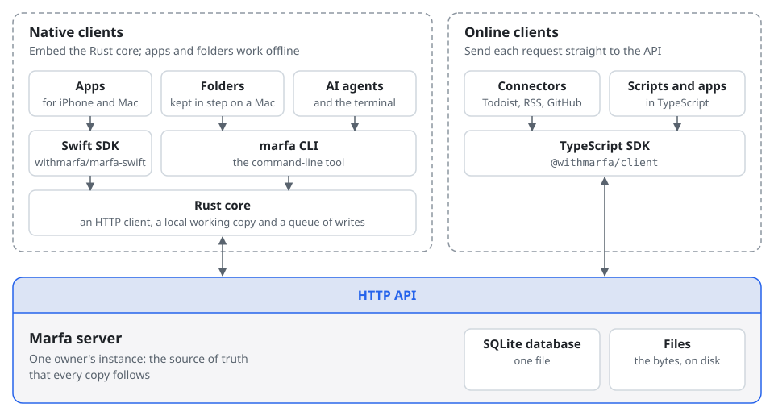

# Marfa

[](https://www.npmjs.com/package/@withmarfa/client)
[](https://www.npmjs.com/package/@withmarfa/core)
[](https://github.com/withmarfa/marfa/releases/latest)
[](https://github.com/withmarfa/marfa/actions/workflows/ci.yml?query=branch%3Amain)
[](./LICENSE)

> **Early project.** Marfa is at version 0.0.x. Things will change without notice, and nothing is stable yet.

Marfa is a home for your personal data that you run yourself. You keep your notes, tasks, reading and other records in one place, in a structure you choose, and any app, script or AI agent you trust can use them. As agents take on more of the typing, apps matter more as ways to look at and use your data than as places that hold it, so your data should not live inside one.

- **Your structure.** Define the kinds of things you keep and how they link. Marfa checks everything against them.
- **Open to every app.** Apps from WithMarfa use the same interface as anything you build.
- **Bring data in.** [Connectors](https://github.com/withmarfa/marfa-connectors) pull in data from other services. GitHub, Todoist and RSS exist today.
- **Use it from anywhere.** A command-line tool, a [TypeScript SDK](./packages/client) and a [Swift SDK](https://github.com/withmarfa/marfa-swift), all built on one HTTP API.
- **Works offline.** Apps built on the Swift SDK keep a copy of the data they need on the device and send their changes when they can reach your instance again.
- **Open source.** Marfa is licensed under the [Apache License 2.0](./LICENSE). If you are interested, open an issue and say hello.

The documentation is at [docs.marfa.so](https://docs.marfa.so).

## How it fits together

<picture>
  <source media="(prefers-color-scheme: dark)" srcset="./assets/architecture-dark.svg">
  <source media="(prefers-color-scheme: light)" srcset="./assets/architecture-light.svg">
  
</picture>

One running Marfa server and its data is an **instance**, and it belongs to one person, its owner. It keeps everything in one SQLite database and a folder of files, so there is no database server to set up. Everything else runs outside the server and reaches it over its HTTP API, with a credential that reaches only the data it was given.

- **Native clients** embed the Rust core in [`core/`](./core). It sends their requests, and it can keep a local working copy of the data a client needs and a queue of its writes, so the client keeps working offline. The [Swift SDK](https://github.com/withmarfa/marfa-swift), the `marfa` CLI and the Node module [`@withmarfa/core`](./core/bindings/node) are built on it. Most CLI commands, such as the ones scripts and AI agents run, go straight to the API; `marfa device` keeps a working copy, and `marfa folders` keeps a folder on your computer in step with the instance, one Markdown file for each note.
- **Online clients** send each request straight to the API, usually through the TypeScript SDK, [`@withmarfa/client`](./packages/client). The [connectors](https://github.com/withmarfa/marfa-connectors) for Todoist, RSS and GitHub are built this way.

The instance is the source of truth. Clients never talk to each other, only to the instance, and the instance decides what happens when two of them change the same thing. [How Marfa works](https://docs.marfa.so/how-marfa-works) explains each part.

## Run your own instance

[](https://railway.com/new/template/5z9-Ja?utm_medium=integration&utm_source=button&utm_campaign=marfa)

The Railway template creates the server and a volume for its data, and generates the server's secrets. Railway bills the service and its storage to your workspace. [Create a personal Marfa instance on Railway](./deploy/railway.md) has the steps, including claiming the instance.

To run Marfa on a computer you own or in a container of your own, follow [Deploy](https://docs.marfa.so/run/deploy).

## Try it locally

You need a Mac with Apple silicon, or Linux on x86_64 or arm64. Install the `marfa` command line and the `marfa-server` program from the latest release:

```bash
curl -fsSL https://raw.githubusercontent.com/withmarfa/marfa/main/scripts/install.sh | sh
```

The script checks the download against the release's checksums and puts both programs in `~/.local/bin`. To install them somewhere else, set `MARFA_INSTALL_DIR`. If the folder isn't on your `PATH`, the script says how to add it.

Then set up a server that only this computer can reach:

```bash
marfa server install --access local
```

The server runs as a service of your computer, a launchd agent on a Mac and a systemd service on Linux, at the address the command prints: <http://localhost:8600> unless that port is taken. Its data and settings are in `~/marfa-server`. The server's two secrets are in `~/marfa-server/marfa.env`: keep a copy of that file somewhere safe, because the data needs them and they aren't stored anywhere else.

A new instance has no owner. The command prints a link that works once, for five minutes: open it and choose the owner's email and password. Claiming the owner signs you in and closes setup permanently. To get a new link, run `marfa server install` again. `marfa server status` shows how the server is, `marfa server uninstall` removes the service and keeps the data, and `marfa server install --help` lists the other ways to reach the server.

The [Quickstart](https://docs.marfa.so/quickstart) continues from here: it makes a key, and writes and reads your first note. To work on Marfa itself, read [`CONTRIBUTING.md`](./CONTRIBUTING.md).

## What is here

| Path                                     | What it is                                                                                                               |
| ---------------------------------------- | ------------------------------------------------------------------------------------------------------------------------ |
| [`@withmarfa/types`](./packages/types)   | Core type and edge JSON schemas; emits the runtime registries                                                            |
| [`@withmarfa/shared`](./packages/shared) | Wire types, Zod validation schemas, error codes                                                                          |
| [`@withmarfa/server`](./packages/server) | The Hono HTTP server, on SQLite                                                                                          |
| [`@withmarfa/client`](./packages/client) | The TypeScript SDK, generated from `openapi.json`                                                                        |
| [`core/`](./core)                        | The Rust engine every native client embeds: a working copy, a queue, the `marfa` binary, and the Swift and Node bindings |
| [`conformance/`](./conformance)          | The contract: black-box fixtures and the written specification under `conformance/spec/`                                 |
| [`deploy/`](./deploy)                    | The container image and the Railway template's guide                                                                     |

## What is authoritative

The committed `openapi.json` and the contract in `conformance/` are what both servers are held to. Where a server and either of them disagree, whichever is wrong is fixed.

- The contract: [`conformance/spec/`](./conformance/spec), with [`coverage.md`](./conformance/spec/coverage.md) naming the fixture behind every published operation.
- The vocabulary: [`GLOSSARY.md`](./GLOSSARY.md).
- Conventions and workflow: [`CONTRIBUTING.md`](./CONTRIBUTING.md) and [`AGENTS.md`](./AGENTS.md).
- The published HTTP surface: [`openapi.json`](./openapi.json), edited directly, with both servers held to it in CI.
