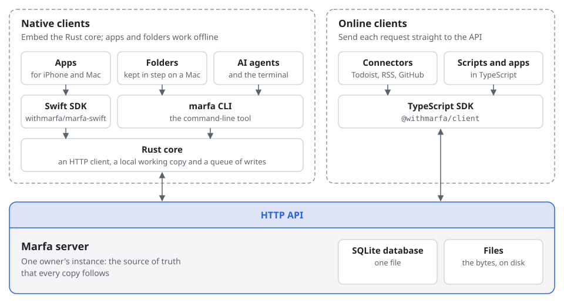

# Marfa

[](https://www.npmjs.com/package/@withmarfa/client)
[](https://www.npmjs.com/package/@withmarfa/core)
[](https://github.com/withmarfa/marfa/releases/latest)
[](https://github.com/withmarfa/marfa/actions/workflows/ci.yml?query=branch%3Amain)
[](./LICENSE)

> **Early project.** Marfa is at version 0.0.x. Things will change without notice, and nothing is stable yet.

Marfa is a home for your personal data that you run yourself. You keep your notes, tasks, reading and other records in one place, in a structure you choose, and any app, script or AI agent you trust can use them. As agents take on more of the typing, apps matter more as ways to look at and use your data than as places that hold it, so your data should not live inside one.

- **Your structure.** Define the kinds of things you keep and how they link. Marfa checks everything against them.
- **Open to every app.** Apps from WithMarfa use the same interface as anything you build.
- **Bring data in.** [Connectors](https://github.com/withmarfa/marfa-connectors) pull in data from other services. GitHub, Todoist and RSS exist today.
- **Use it from anywhere.** A command-line tool, a [TypeScript SDK](./packages/client) and a [Swift SDK](https://github.com/withmarfa/marfa-swift), all built on one HTTP API.
- **Works offline.** Apps keep a copy of the data they need on the device and send their changes when they can reach your instance again.
- **Open source.** Marfa is licensed under the [Apache License 2.0](./LICENSE). If you are interested, open an issue and say hello.

The documentation is at [docs.marfa.so](https://docs.marfa.so).

## How it fits together

<picture>
  <source media="(prefers-color-scheme: dark)" srcset="./assets/architecture-dark.svg">
  <source media="(prefers-color-scheme: light)" srcset="./assets/architecture-light.svg">
  
</picture>

One running Marfa server and its data is an **instance**, and it belongs to one person, its owner. It keeps everything in one SQLite database and a folder of files, so there is no database server to set up. Everything else runs outside the server and reaches it over its HTTP API, with a credential that reaches only the data it was given.

- **Native clients** embed the Rust core in [`core/`](./core), which keeps a local working copy of the data a client needs and a queue of its writes. The [Swift SDK](https://github.com/withmarfa/marfa-swift), the `marfa` CLI and the Node module [`@withmarfa/core`](./core/bindings/node) are built on it. The CLI also keeps folders on a Mac in step with the instance, one Markdown file for each note.
- **Online clients** send each request straight to the API, usually through the TypeScript SDK, [`@withmarfa/client`](./packages/client). The [connectors](https://github.com/withmarfa/marfa-connectors) for Todoist, RSS and GitHub are built this way.

The instance is the source of truth. Clients never talk to each other, only to the instance, and the instance decides what happens when two of them change the same thing. [How Marfa works](https://docs.marfa.so/how-marfa-works) explains each part.

## Run your own instance

[](https://railway.com/new/template/5z9-Ja?utm_medium=integration&utm_source=button&utm_campaign=marfa)

The Railway template creates the server, a volume for its data and a private bucket for backups, and generates the server's secrets. Railway bills the service and its storage to your workspace. [Create a personal Marfa instance on Railway](./deploy/railway.md) has the steps, including claiming the instance.

To run Marfa on a computer you own or in a container of your own, follow [Deploy](https://docs.marfa.so/guides/deploy).

## Try it locally

You need macOS or Linux, with Git, [Node.js](https://nodejs.org) 22.12 or later and [pnpm](https://pnpm.io/installation). On Linux, also install the `acl` package, which the server uses to check who may reach its private socket. Clone Marfa, build it and start the server:

```bash
git clone https://github.com/withmarfa/marfa.git
cd marfa
pnpm install
pnpm build
cd packages/server
export MARFA_AUTH_SECRET="$(openssl rand -hex 32)"
pnpm dev    # http://localhost:8600
```

A new instance has no owner. Open <http://localhost:8600/setup>, enter the setup code printed in the server's terminal, and choose the owner's email and password. Claiming the owner closes setup permanently.

The [Quickstart](https://docs.marfa.so/quickstart) continues from here: it installs the CLI, makes a key, and writes and reads your first note. To work on Marfa itself, read [`CONTRIBUTING.md`](./CONTRIBUTING.md).

## What is here

| Path                                     | What it is                                                                                                               |
| ---------------------------------------- | ------------------------------------------------------------------------------------------------------------------------ |
| [`@withmarfa/types`](./packages/types)   | Core type and edge JSON schemas; emits the runtime registries                                                            |
| [`@withmarfa/shared`](./packages/shared) | Wire types, Zod validation schemas, error codes                                                                          |
| [`@withmarfa/server`](./packages/server) | The Hono HTTP server, on SQLite                                                                                          |
| [`@withmarfa/client`](./packages/client) | The TypeScript SDK, generated from `openapi.json`                                                                        |
| [`core/`](./core)                        | The Rust engine every native client embeds: a working copy, a queue, the `marfa` binary, and the Swift and Node bindings |
| [`conformance/`](./conformance)          | The contract: black-box fixtures and the written specification under `conformance/spec/`                                 |
| [`deploy/`](./deploy)                    | The container image and the Railway template's guide                                                                     |

## What is authoritative

The server's behavior is the specification, and `conformance/` is where that behavior is written down and held. Where a document and the server disagree, the server is right and the document is a defect.

- The contract: [`conformance/spec/`](./conformance/spec), with [`coverage.md`](./conformance/spec/coverage.md) naming the fixture behind every published operation.
- The vocabulary: [`GLOSSARY.md`](./GLOSSARY.md).
- Conventions and workflow: [`CONTRIBUTING.md`](./CONTRIBUTING.md) and [`AGENTS.md`](./AGENTS.md).
- The published HTTP surface: [`openapi.json`](./openapi.json), written by `pnpm generate` from the routes and checked against them in CI.
